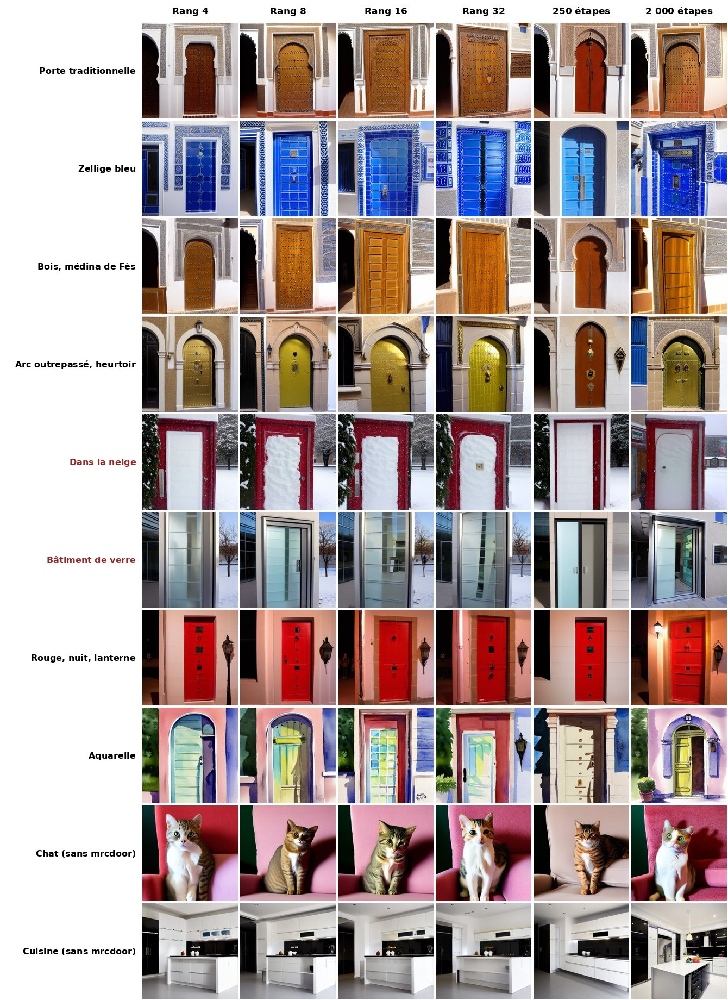

# LoRA texte-image : portes marocaines

Projet 5 · IA générative visuelle. On spécialise **Stable Diffusion 1.5** sur un domaine précis
(les portes traditionnelles marocaines) avec une **LoRA**, à partir de 20 à 50 images, sans
réentraîner tout le modèle. Tout tourne sur Google Colab ou Kaggle (GPU T4, moins de 12 Go de VRAM).

## Résultats principaux

Une LoRA de rang 16 (12,8 Mo, 26 min sur GPU T4, 2,1 Go de VRAM) fait passer le CLIPScore de 31,5 à 35,2 sur les prompts du domaine, sans aucune copie des images d'entraînement.

| LoRA (1 000 étapes, intensité 1,0) | CLIPScore ↑ | Proximité domaine ↑ | Quasi-copies ↓ | Taille | Temps d'entraînement |
|------|-------------|--------------------|----------------|--------|-----------------|
| base (sans LoRA) | 31,5 | 0,731 | – | – | – |
| rang 4 | 33,3 | 0,752 | 0 % | 3,2 Mo | 25,7 min |
| rang 8 | 35,0 | 0,764 | 0 % | 6,4 Mo | 25,7 min |
| **rang 16** | **35,2** | **0,788** | 0 % | 12,8 Mo | 25,8 min |
| rang 32 | 35,3 | 0,783 | 0 % | 25,6 Mo | 25,9 min |

- La qualité plafonne vers 1 250 étapes (`results/figures/surapprentissage_etapes.png`).
- Le concept se combine avec une couleur ou l'aquarelle, mais disparaît dans un bâtiment de verre moderne.
- Configuration recommandée : rang 16, 1 000 à 1 250 étapes, intensité 0,8.



## Installation

```bash
git clone https://github.com/oussioumaima7-star/lora-portes-marocaines.git
cd lora-portes-marocaines
pip install -r requirements.txt      # torch est déjà présent sur Colab/Kaggle
```

L'entraînement et l'évaluation complets se lancent sur Kaggle avec `notebooks/kaggle_entrainement.ipynb` (tout le pipeline est dans `scripts/run_kaggle.py`). Les notebooks 01 à 05 servent sur Colab.

## Commandes

| Étape | Commande |
|------|----------|
| 1. Télécharger les candidates (avec licences) | `python data/download_commons.py --category "Doors in Morocco" --depth 1` |
| 2. Trier à la main `data/raw/` | — |
| 3. Préparer 512×512, doublons, split | `python data/prepare.py --heldout 8` |
| 4. Pré-légender puis corriger | `python -m src.auto_caption` puis éditer `data/captions.csv` |
| 5. Entraîner | `python -m src.train_lora --config configs/rank8.yaml` |
| 6. Générer | `python -m src.generate --lora results/loras/rank8/final --prompt "a mrcdoor in the snow"` |
| 7. Évaluer | `python -m src.evaluate --loras results/loras/rank*/final` |
| 8. Figures | `python -m src.plots` |
| 9. Démo | `python demo/app.py --share` |

## Organisation du dépôt

```
README.md
notebooks/   01_donnees · 02_baseline · 03_entrainement · 04_evaluation · 05_demo
src/         train_lora.py · generate.py · evaluate.py · plots.py · auto_caption.py · config.py
configs/     base.yaml · rank{4,8,16,32}.yaml · steps_long.yaml · eval.yaml
data/        download_commons.py · prepare.py · sources.csv · captions.csv · README.md (fiche)
results/     figures/ · eval/metrics.csv · grilles (les LoRA restent hors Git)
demo/        app.py (Gradio) · vidéo courte
report/      rapport final (6-8 pages)
docs/        guide_concepts.md · model_card.md · ethique.md · licences.md
```

## Expériences

1. **Baseline** : Stable Diffusion 1.5 seul, sur les mêmes prompts.
2. **Première LoRA** : rang 8, 1000 étapes.
3. **Rangs** : 4, 8, 16, 32 à étapes égales. Effet sur la qualité, la taille et le surapprentissage.
4. **Étapes** : rang 8 jusqu'à 2000 étapes, avec un checkpoint tous les 250 pas, pour trouver le moment où le surapprentissage commence.
5. **Intensité** : échelle LoRA de 0.5, 0.8 et 1.0 à l'inférence.

Les définitions des métriques sont expliquées dans `src/evaluate.py` et `docs/guide_concepts.md`.

## Planning conseillé

| Semaine | Travail | Livrable Git |
|---------|---------|--------------|
| 1 | Collecte, tri, licences | `data/sources.csv` |
| 2 | Préparation, légendes, baseline | `data/captions.csv`, notebook 02 |
| 3 | Première LoRA, réglages | `results/loras/rank8` (sur Drive), premiers échantillons |
| 4 | Rangs + étapes | `metrics_train.json` de chaque run |
| 5 | Évaluation, figures, analyse des échecs | `results/eval`, `results/figures` |
| 6 | Démo, rapport, fiche modèle, répétition | `demo/`, `report/`, `docs/` |

## Équipe

| Membre | Rôle principal | Fichiers dont il/elle est responsable |
|--------|----------------|---------------------------------------|
| Oumaima Oussi | Données, licences, éthique | `data/`, `notebooks/01_donnees`, `docs/licences.md`, `docs/ethique.md` |
| Younes Lallaoui | Baseline et entraînement des LoRA | `configs/`, `src/train_lora.py`, `notebooks/02_baseline`, `notebooks/03_entrainement` |
| Aymane Barkat | Évaluation, figures, démo | `src/evaluate.py`, `src/plots.py`, `notebooks/04_evaluation`, `demo/`, `docs/model_card.md` |

Le rapport est rédigé à trois : chacun écrit la partie qui correspond à son rôle, et l'introduction et la conclusion sont faites ensemble.

## Vidéo de la démo

[demo/demo.mp4](demo/demo.mp4) : même prompt et même seed, avec la LoRA à une intensité de 0, puis 0,8, puis 1,5.

## Contributions

| Membre | Partie |
| --- | --- |
| Oumaima Oussi | Données, licences, éthique |
| Younes Lallaoui | LoRA, entraînement |
| Aymane Barkat | Évaluation, démo |

Le rapport et la soutenance ont été préparés ensemble.
